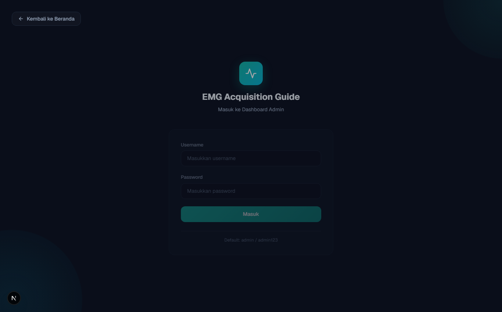
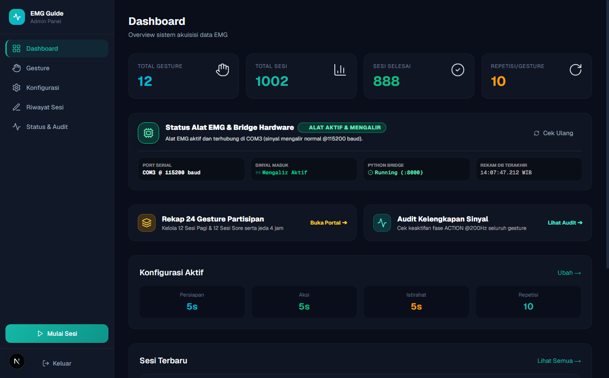
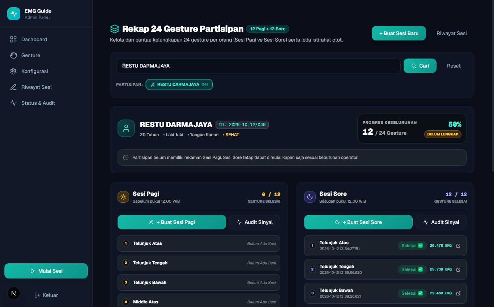
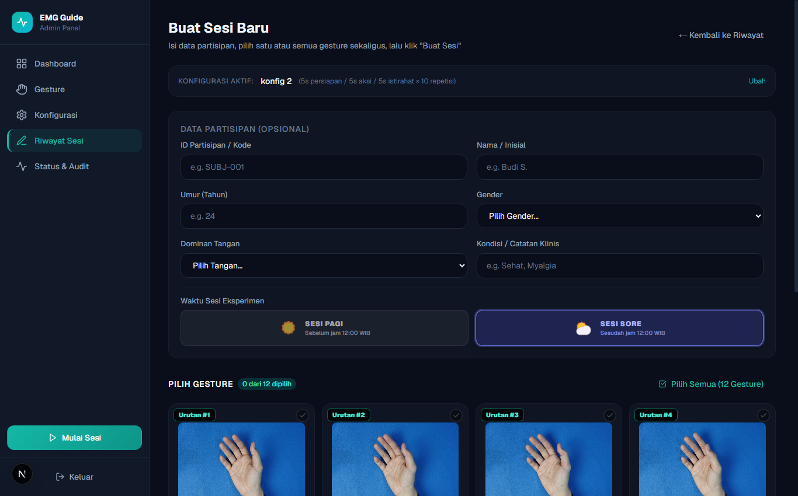
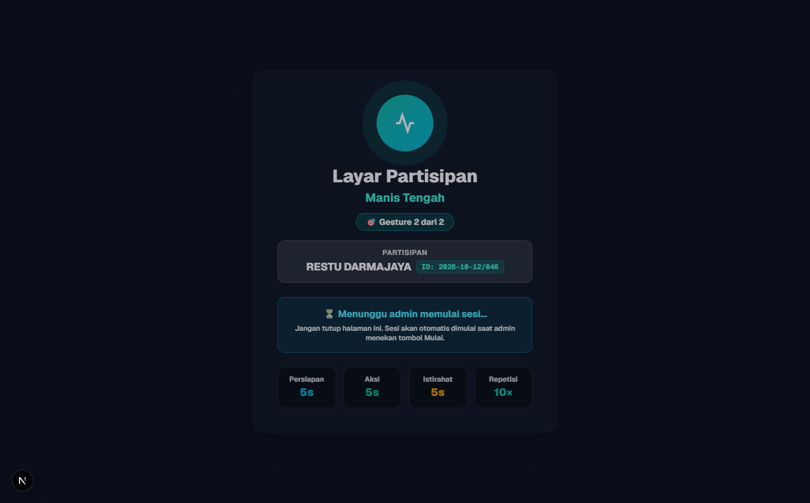
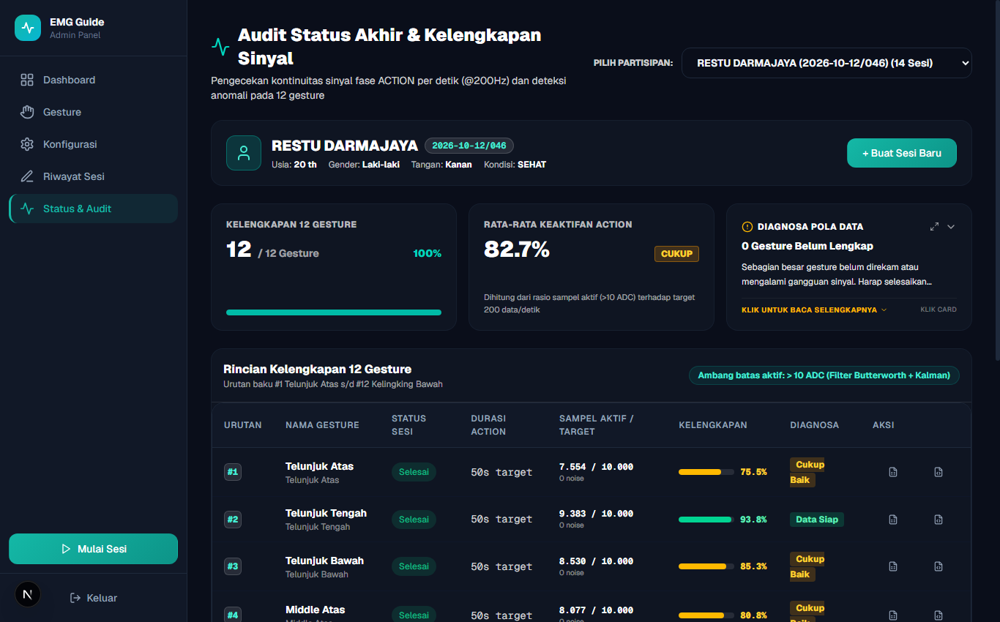
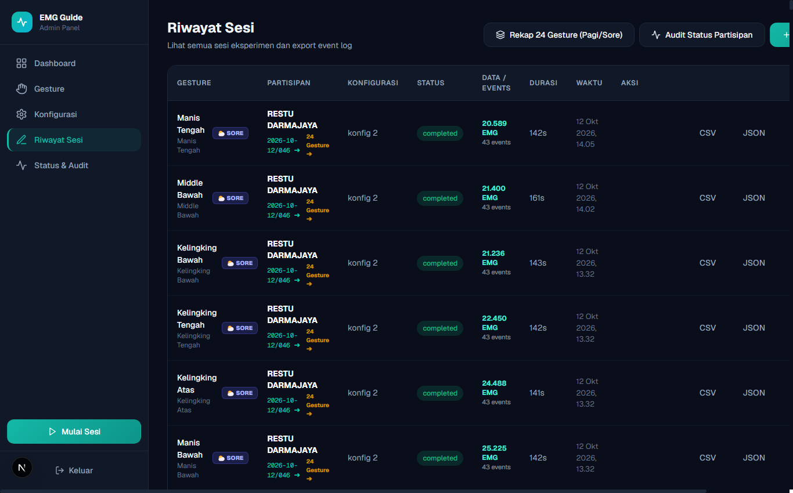

# PANDUAN MANUAL PENGGUNAAN SISTEM AKUISISI DATA SURFACE ELECTROMYOGRAPHY (sEMG)

Dokumen ini disusun sebagai panduan operasional praktis penggunaan sistem akuisisi data sEMG 6-channel berbasis **Next.js Web Master Clock** dan **Python Serial Bridge** untuk kebutuhan lampiran laporan skripsi/penelitian.

---

## 1. Persiapan Awal & Menjalankan Sistem

Sebelum membuka web browser, pastikan perangkat keras dan layanan backend telah dijalankan dengan urutan berikut:

1. **Hubungkan Hardware**: Tancapkan mikrokontroler Seeed XIAO nRF52840 yang telah terpasang 6 modul sensor EMG ke port USB laptop/PC (Port baku: `COM3 @ 115200 baud`). Pastikan saklar daya alat dalam posisi **ON**.
2. **Jalankan Database PostgreSQL**: Pastikan servis PostgreSQL aktif di `localhost:5432` dengan database `emg_db`.
3. **Jalankan Python Bridge**: Buka terminal dan jalankan script penghubung serial:
   ```bash
   python emg_bridge.py
   ```
   *(Bridge akan otomatis membuka port `COM3` dan menjalankan server lokal di `http://127.0.0.1:8000`)*.
4. **Jalankan Web Server**: Buka terminal kedua di direktori project `c:\sEMG` dan jalankan:
   ```bash
   npm run dev
   ```
   *(Aplikasi web dapat diakses melalui browser di `http://localhost:3000`)*.

---

## 2. Login ke Sistem Web

Buka browser dan akses alamat `http://localhost:3000`. Sistem akan mengarahkan ke halaman login administrasi:


*Gambar 1: Antarmuka Halaman Login Admin*

* **Username Default**: `admin`
* **Password Default**: `admin123`
* Klik tombol **Masuk** untuk mengakses Dashboard.

---

## 3. Monitoring Dashboard & Status Hardware

Setelah login, operator diarahkan ke Dashboard Utama yang memuat ringkasan statistik dan kartu telemetri hardware secara *real-time*:


*Gambar 2: Dashboard Admin dengan Indikator Status Hardware Aktif*

### Keterangan Indikator Status Alat:
* **🟢 ALAT AKTIF & MENGALIR**: Mikrokontroler nRF52840 terhubung di COM3 dan sinyal streaming 12-channel (raw + envelope) terdeteksi mengalir aktif ke memori.
* **🔴 ALAT MATI / TIDAK TERDETEKSI**: Peringatan otomatis apabila saklar daya alat OFF atau kabel USB terlepas di tengah jalan, mencegah hilangnya data eksperimen.
* **⚪ BRIDGE OFFLINE**: Menandakan script `python emg_bridge.py` belum dijalankan di terminal.

---

## 4. Manajemen Partisipan & Protokol Waktu (Pagi/Sore)

Pilih menu **Rekap 24 Gesture Partisipan** untuk memantau kelengkapan protokol pengambilan data tiap subjek eksperimen:


*Gambar 3: Halaman Rekap 24 Gesture Partisipan (Sesi Pagi & Sesi Sore)*

### Fitur Utama:
1. **Pencarian Subjek**: Operator dapat mengetik Nama atau ID Partisipan (misal: `RESTU DARMAJAYA` atau `2026-10-12/046`).
2. **Protokol 24 Gesture**: Menampilkan pemisahan kuota **12 Sesi Pagi** (sebelum jam 12.00) dan **12 Sesi Sore** (sesudah jam 12.00).
3. **Status Kelengkapan**: Menampilkan persentase kelengkapan data per orang serta tombol cepat untuk langsung membuat sesi berikutnya.

---

## 5. Pembuatan Sesi Akuisisi Baru

Untuk memulai pengambilan data, klik tombol **+ Buat Sesi Baru** atau **Mulai Sesi**:


*Gambar 4: Formulir Pembuatan Sesi Akuisisi dan Pemilihan Gesture*

### Langkah Pengisian:
1. **Data Partisipan**:
   * **ID Partisipan**: Masukkan kode unik subjek (misal: `2026-10-12/046`).
   * **Nama / Inisial**: Nama lengkap partisipan.
   * **Umur, Gender, Dominan Tangan**: Pilih opsi sesuai biodata partisipan.
   * **Waktu Sesi**: Pilih **Sesi Pagi** atau **Sesi Sore**.
2. **Pilihan Gesture**:
   * Pilih salah satu gesture dari 12 gesture tangan baku, atau klik **Pilih Semua (12 Gesture)** untuk menjadwalkan seluruh rangkaian secara berurutan.
3. Klik tombol **Buat Sesi & Mulai** di bagian bawah.

---

## 6. Pelaksanaan Akuisisi Data (Layar Panduan Partisipan)

Sistem akan membuka layar panduan subjek (`/session/[id]`). Layar ini dirancang khusus agar mudah dilihat oleh partisipan saat melakukan gerakan tangan:


*Gambar 5: Layar Tunggu Partisipan Menampilkan ID, Nama, dan Konfigurasi Timing*

### Siklus Eksekusi Master Clock:
1. **Layar Tunggu**: Memperlihatkan Nama Partisipan, ID Partisipan, dan Nama Gesture. Operator memastikan elektroda terpasang baik lalu menekan **Mulai**.
2. **Countdown Pra-Mulai (3-2-1)**: Memberikan jeda bagi subjek untuk bersiap.
3. **Siklus 3 Fase (Diulang 10 Repetisi)**:
   * **Fase PERSIAPAN (5 Detik)**: Warna latar kuning/amber. Subjek bersiap menirukan video gesture.
   * **Fase AKSI (5 Detik)**: Warna latar hijau terang. Subjek melakukan kontraksi gerakan tangan sesuai video peragaan. Python Bridge otomatis menempelkan label supervised `phase = ACTION`.
   * **Fase ISTIRAHAT (5 Detik)**: Warna latar biru rileks. Subjek mengistirahatkan otot tangan sepenuhnya.
4. **Proteksi Hardware**: Terdapat pill status koneksi di pojok kanan atas. Jika alat terputus di tengah sesi, banner merah otomatis muncul memberi peringatan.

---

## 7. Diagnosa Kualitas Sinyal & Kesiapan Machine Learning

Setelah sesi selesai, operator dapat membuka menu **Status & Audit** (`/admin/status`) untuk mengevaluasi integritas sinyal EMG:


*Gambar 6: Dashboard Diagnosa Kualitas Sinyal dan Kesiapan ML*

### Parameter Evaluasi:
* **Rata-rata Keaktifan ACTION**: Persentase sampel aktif saat fase aksi berlangsung (sinyal melebihi threshold amplitudo dasar kontraksi).
* **Diagnosa Pola Data**: Card interaktif yang dapat diklik untuk membaca telaah klinis/teknis kualitas kontraksi otot partisipan.
* **Status "Data Siap"**: Label hijau menandakan data memenuhi kualifikasi SNR tinggi dan siap digunakan langsung sebagai input pelatihan model Machine Learning / Deep Learning tanpa perlu segmentasi ulang.

---

## 8. Riwayat Sesi & Unduh Dataset

Seluruh rekaman tersimpan secara permanen di database PostgreSQL dan dapat diunduh kapan saja melalui menu **Riwayat Sesi** (`/admin/sessions`):


*Gambar 7: Tabel Riwayat Sesi dengan Tombol Ekspor CSV dan JSON*

### Fitur Ekspor:
* **Tombol JSON**: Mengunduh dataset berstruktur lengkap mencakup metadata partisipan, konfigurasi durasi, log transisi fase waktu WIB, serta seluruh baris data 6-channel sEMG (`r1..r6`, `p1..p6`, `phase`, `elapsedMs`, `sampleIndex`).
* **Tombol CSV**: Mengunduh format matriks tabular baris per sampel yang siap diolah menggunakan Python Pandas, NumPy, atau MATLAB.
